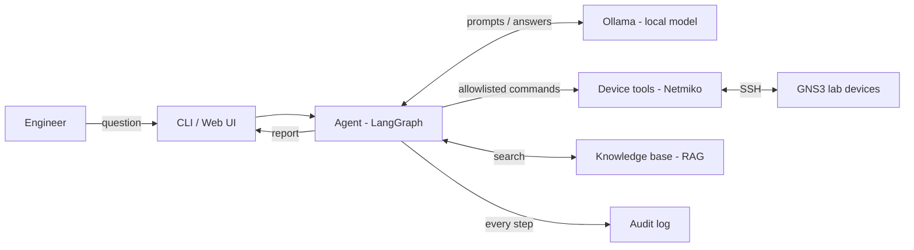

# Rootvex Manual

A step-by-step guide to building, running, and growing Rootvex — a
self-hosted AI agent for network and security engineers.

- **Part 1** explains what the project is and how it works.
- **Part 2** gets your machine and lab ready.
- **Part 3** walks through every build phase, starting with Phase 0.
- **Part 4** covers daily use, safety, and troubleshooting.

Anything marked *(planned)* describes how it will work once that phase is
built; commands and file names may change as the code is written.

---

## Contents

1. [Part 1 — The project](#part-1--the-project)
2. [Part 2 — Prerequisites](#part-2--prerequisites)
3. [Part 3 — Build phases](#part-3--build-phases)
   - [Phase 0 — Plan](#phase-0--plan)
   - [Phase 1 — Skeleton](#phase-1--skeleton)
   - [Phase 2 — Agent loop](#phase-2--agent-loop)
   - [Phase 3 — Read-only device tools](#phase-3--read-only-device-tools)
   - [Phase 4 — Troubleshooting playbooks](#phase-4--troubleshooting-playbooks)
   - [Phase 5 — Knowledge base (RAG)](#phase-5--knowledge-base-rag)
   - [Phase 6 — Evaluation](#phase-6--evaluation)
   - [Phase 7 — API and web UI](#phase-7--api-and-web-ui)
   - [Phase 8 — Approved configuration changes](#phase-8--approved-configuration-changes)
   - [Phase 9 — Packaging](#phase-9--packaging)
4. [Part 4 — Using and operating Rootvex](#part-4--using-and-operating-rootvex)
5. [Glossary](#glossary)

---

## Part 1 — The project

### What Rootvex does

You describe a problem in plain language — *"OSPF neighbor between R1 and R2
is down"* — and Rootvex:

1. **Understands** the issue and picks a troubleshooting approach.
2. **Plans** which checks to run.
3. **Collects evidence** by running read-only commands on lab devices.
4. **Analyzes** the output, using its knowledge base for reference.
5. **Reports** the likely cause, the evidence, a proposed fix, its confidence,
   and next steps.

It never changes a device unless you approve a specific diff (Phase 8).

### What it is not

- Not a replacement for the engineer — it gathers evidence and suggests; you decide.
- Not for production or employer networks — lab only.
- Not a model trained from scratch — it uses existing open-weight models,
  optionally fine-tuned later.

### How it works



| Component | Role |
|---|---|
| **Ollama** | Runs the language model locally and serves an OpenAI-compatible API |
| **Agent (LangGraph)** | The control loop: decides the next step, calls tools, stops when done |
| **Device tools (Netmiko)** | SSH to devices and run only commands on the allowlist |
| **Playbooks** | Ordered checks for common problems, written by you |
| **Knowledge base (RAG)** | Vendor docs, lab notes, and runbooks the agent can search and cite |
| **Audit log** | Records every prompt, tool call, and command, with secrets redacted |
| **CLI / API / UI** | How you talk to the agent |

### The safety model

These rules apply in every phase and are enforced in code, not just in prompts:

| Rule | How it's enforced |
|---|---|
| Lab only | Devices come only from your local inventory file |
| Read-only by default | Deny-by-default command allowlist checked before every SSH command |
| Human approval for changes | Separate change tool; requires diff + explicit approval + rollback plan |
| Untrusted input | Device output and documents are treated as data, never as instructions |
| No leaked secrets | Credentials only in `.env`; logs redacted; `.gitignore` blocks key files |
| Bounded runs | Step limit and timeout on every agent run |

---

## Part 2 — Prerequisites

### Machine

Already set up — see [`SETUP_LOG.md`](SETUP_LOG.md) for details and fixes.

| Item | Status |
|---|---|
| Ubuntu 26.04 LTS on Dell Precision 7810 | ✅ |
| NVIDIA GTX 1060 6 GB, driver 580 (`nvidia-smi` works) | ✅ |
| Network on router LAN3/LAN4 | ✅ |
| Docker (`docker run hello-world` without sudo) | ⬜ confirm |
| Git + GitHub SSH + `gh` CLI | ✅ |
| Ollama with a test model on GPU | ⬜ |
| GNS3 lab | ⬜ |
| Claude Code | ⬜ |

### Check the machine

```bash
nvidia-smi                 # GPU and driver
free -h                    # RAM
df -h / /data              # disk space (adjust paths)
docker run hello-world     # Docker without sudo
python3 --version
```

### Install Ollama and test the GPU

```bash
curl -fsSL https://ollama.com/install.sh | sh
ollama run granite4:3b      # ask a question, then /bye
ollama ps                   # PROCESSOR should show 100% GPU
```

Confirm a model tag exists in the Ollama library before pulling it — model
names change often.

### Store models on the 1 TB disk (optional)

Models fill the 256 GB SSD quickly. To keep them on the HDD, mount it (for
example at `/data`), then:

```bash
sudo mkdir -p /data/ollama && sudo chown ollama:ollama /data/ollama
sudo systemctl edit ollama
# add:
# [Service]
# Environment="OLLAMA_MODELS=/data/ollama"
sudo systemctl restart ollama
```

### Build the GNS3 lab (needed by Phase 3)

Start small: two routers running OSPF, reachable over SSH from the Ubuntu host.

```
 [Ubuntu host] ── mgmt switch ──┬── R1 (Gi0/0 mgmt)
                                └── R2 (Gi0/0 mgmt)
            R1 Gi0/1 ─── 10.0.12.0/30 ─── R2 Gi0/1   (OSPF area 0)
```

Router images:
- **Cisco IOSv / CSR / Cat8000v** — use only images you are licensed for
  (for example through Cisco Modeling Labs).
- **Free alternatives** — VyOS or FRRouting containers/VMs; Netmiko supports
  both, so you can start without Cisco images.
- **FortiGate VM** — the free trial/evaluation VM works for Phase 3 extensions.

Minimum router config for SSH (Cisco example):

```
hostname R1
ip domain-name lab.local
username netwarden privilege 15 secret <lab-only-password>
crypto key generate rsa modulus 2048
ip ssh version 2
line vty 0 4
 login local
 transport input ssh
```

Use a **read-only** account later (privilege level or role-based CLI) once the
tools are working — the allowlist protects you in software, a limited account
protects you on the device.

### Start Claude Code

```bash
cd ~/projects/rootvex
claude
```

First message:

> Read `docs/PROJECT_PROMPT.md` and follow it. Start with Phase 0.

---

## Part 3 — Build phases

Every phase follows the same loop:

1. **Ask** Claude Code to start the phase.
2. **Review** its plan before it writes code.
3. **Let it build**, in small commits.
4. **Test** using the steps under each phase below.
5. **Approve** only when the "Done when" list is complete; then move on.

Keep each phase on a branch (`phase-1-skeleton`, …) and merge to `main` when
it passes. If something goes wrong, you can always return to the last good
commit.

---

### Phase 0 — Plan

**Goal:** agree on the design before any code exists. This is the cheapest
time to change your mind.

**What to ask Claude Code**

> Read `docs/PROJECT_PROMPT.md`. Check my environment (GPU, RAM, disk,
> Python, Docker, Ollama), then write `docs/DESIGN.md` covering the sections
> listed in the manual's Phase 0. Don't write application code yet.

**What `docs/DESIGN.md` must contain**

| Section | Questions it answers |
|---|---|
| Environment report | What did it find on the machine? Any blockers (e.g., Pascal GPU limits)? |
| Goals and non-goals | What will v1 do? What is explicitly out of scope? |
| Architecture | Components, how they connect, a diagram |
| Agent flow | The LangGraph states/nodes, when it stops, step and time limits |
| Tool contract | How tools are defined, validated, and logged |
| Safety design | Allowlist format, approval flow, injection handling, secret handling |
| Data | Where inventory, allowlist, logs, documents, and vectors are stored |
| Tech choices | Each library with a **verified, pinned version** and why |
| Model plan | Default model for 6 GB VRAM, how to switch models by config |
| Repo structure | Folder and file layout (see suggestion below) |
| Testing strategy | Unit tests with mocked devices, lab tests, evaluation |
| Risks and open questions | What could go wrong; what Claude Code needs from you |

**Suggested repo structure** (Claude Code may propose changes — judge them)

```
rootvex/
├── pyproject.toml            # dependencies, managed with uv
├── .env.example              # variable names only, no values
├── config/
│   ├── settings.yaml         # model, limits, paths
│   ├── inventory.example.yaml
│   └── allowlist.yaml        # permitted commands per platform
├── src/rootvex/
│   ├── config.py             # load settings + env
│   ├── logging.py            # audit log with redaction
│   ├── llm.py                # Ollama client
│   ├── agent/                # graph, state, prompts
│   ├── tools/                # device tools, allowlist checker
│   ├── playbooks/            # troubleshooting playbooks (YAML)
│   ├── rag/                  # ingest + retrieve
│   ├── api/                  # FastAPI app (Phase 7)
│   └── cli.py                # command-line entry point
├── tests/                    # pytest, mocked device output
├── evals/                    # scenarios + scoring script (Phase 6)
├── docs/
└── docker-compose.yml        # Phase 9
```

**Review checklist before approving Phase 0**

- [ ] The environment report matches reality (`nvidia-smi`, `free -h`).
- [ ] Safety rules from Part 1 appear in the design **as code mechanisms**,
      not only as prompt instructions.
- [ ] Every library has a pinned version that Claude Code actually checked.
- [ ] The default model fits in 6 GB VRAM, and switching models is config-only.
- [ ] Nothing in the design needs internet access at runtime except model downloads.
- [ ] Open questions are answered (reply to them in the chat).
- [ ] You understand every component well enough to explain it.

**Done when:** `docs/DESIGN.md` is committed, you've approved it, and open
questions are resolved.

---

### Phase 1 — Skeleton

**Goal:** a clean, installable project with config, logging, and tests — no AI yet.

**Builds:** repo layout, `pyproject.toml`, settings loader, `.env.example`,
audit logger with redaction, `.gitignore`, README setup steps, one passing test.

**Test it** *(planned)*
```bash
uv sync
uv run pytest
uv run rootvex version
git status        # .env must NOT appear
```

**Done when:**
- [ ] Fresh clone → `uv sync` → tests pass.
- [ ] A test proves secrets are redacted from logs.
- [ ] No secrets or real IPs in the repo.

---

### Phase 2 — Agent loop

**Goal:** the agent can think and call a tool, end to end, using your local model.

**Builds:** LangGraph graph, Ollama client, one **fake** tool (for example
`get_interface_status` returning canned data), step limit, timeout, CLI.

**Test it** *(planned)*
```bash
uv run rootvex ask "Why is Gi0/1 down on R1?"
```
Then read the audit log and confirm each step was recorded.

**Done when:**
- [ ] The agent calls the fake tool and uses its result in the answer.
- [ ] Step limit and timeout stop a runaway loop (there is a test for this).
- [ ] Changing the model in `settings.yaml` works without code changes.

**Tip:** small models are weaker at tool calling. If the 3B model struggles,
try `qwen3.5:9b` (slower on 6 GB) before blaming the code.

---

### Phase 3 — Read-only device tools

**Goal:** real evidence from real (lab) devices, safely.

**Builds:** inventory loader, allowlist checker, Netmiko tools with
per-device timeouts, structured results, mocked tests, then lab tests.

**Allowlist example** *(planned format)*
```yaml
cisco_ios:
  allow:
    - "show ip interface brief"
    - "show interfaces *"
    - "show ip ospf neighbor"
    - "show ip route*"
    - "show logging*"
  deny:
    - "*configure*"
    - "*reload*"
    - "*write*"
    - "*copy*"
    - "*delete*"
```

**Test it**
1. Mocked tests pass with no devices running.
2. Start the GNS3 lab; ask: *"List interfaces on R1 and their status."*
3. Ask the agent to run a forbidden command (e.g., *"reload R1"*) — it must
   refuse, and the refusal must appear in the log.

**Done when:**
- [ ] Forbidden commands are blocked by code even if the model requests them.
- [ ] Unreachable devices fail cleanly with a clear message.
- [ ] Credentials never appear in logs or output.

---

### Phase 4 — Troubleshooting playbooks

**Goal:** encode your expertise so the agent checks things in the right order.

**Starter playbooks**

| Playbook | Core checks |
|---|---|
| Interface down / flapping | Status, errors/CRC, duplex/speed, logs for up/down events |
| OSPF neighbor down | Interface up, IP/subnet, area, hello/dead timers, auth, MTU, passive interface |
| BGP neighbor down | Reachability to peer, AS numbers, update-source, timers, ACLs |
| IPsec VPN down | Phase 1/2 status, proposals, PSK, peer reachability, NAT-T |
| "User can't reach a website" | DNS, default gateway, routing, ACL/policy, NAT, MTU |

**Test it:** break the lab on purpose (shut an interface, change an OSPF
area, mismatch a timer) and ask Rootvex to find the cause.

**Done when:**
- [ ] Each playbook finds its planted fault in the lab.
- [ ] Reports cite the command output that proves the cause.

---

### Phase 5 — Knowledge base (RAG)

**Goal:** answers grounded in documentation and your own notes, with citations.

**Builds:** document ingestion (Markdown, PDF, text), local embeddings
(BGE-M3 if available in Ollama), a local vector store, retrieval tool, cited answers.

**What to feed it:** vendor configuration guides you're allowed to store,
your lab notes, your runbooks. Never employer documents.

**Done when:**
- [ ] Answers cite the document and section they used.
- [ ] Asking about something not in the documents produces "I don't know"
      rather than an invented answer.

---

### Phase 6 — Evaluation

**Goal:** measure whether Rootvex is actually good — and catch regressions.

**Builds:** 20+ scenarios in `evals/scenarios/`, each with a lab fault and
the expected root cause, plus a script that runs them and scores results.

**Scenario example** *(planned format)*
```yaml
id: ospf-area-mismatch
setup: "On R2 Gi0/1, put the interface in OSPF area 1 instead of 0"
question: "R1 and R2 are not forming an OSPF adjacency. Why?"
expected_cause: "OSPF area mismatch on the R1–R2 link"
must_mention: ["area", "Gi0/1"]
```

**Track per run:** root-cause accuracy, invented facts, steps used, time taken.

**Done when:**
- [ ] The scoring script runs all scenarios and prints a summary.
- [ ] You have a baseline score to compare against after every change.

---

### Phase 7 — API and web UI

**Goal:** use Rootvex from a browser or other tools.

**Builds:** FastAPI endpoints (ask, run history, health), optional
Open WebUI connection, simple authentication.

**Done when:**
- [ ] The API is reachable only from your LAN (or localhost) and requires auth.
- [ ] Every request appears in the audit log.

---

### Phase 8 — Approved configuration changes

**Goal:** let Rootvex fix things — only with your explicit approval.

**Flow**
1. Agent proposes a change with the **exact commands** and a **diff** of the
   running config.
2. You approve or reject (CLI prompt or UI button). No approval → nothing happens.
3. A separate, restricted change tool applies it.
4. The agent verifies the fix with read-only checks.
5. If verification fails, it applies the rollback commands.

**Done when:**
- [ ] No code path can change a device without an approval record.
- [ ] Rollback is tested for every change type.
- [ ] Approvals, changes, and rollbacks are all logged.

---

### Phase 9 — Packaging

**Goal:** the whole stack starts with one command and is easy to show others.

**Builds:** `docker-compose.yml` (agent, API, vector store, optional
Open WebUI; Ollama on the host or in a GPU container via the NVIDIA Container
Toolkit), full docs, a demo script for recordings.

**Done when:**
- [ ] A fresh Ubuntu machine can run Rootvex by following the README.
- [ ] The demo works end to end in the GNS3 lab.

---

## Part 4 — Using and operating Rootvex

### Asking good questions *(planned)*

Include the device, the symptom, and what changed:

> ✅ "R1 and R2 lost their OSPF adjacency after I changed R2's interface config."
> ❌ "Network broken."

### Reading a report

| Field | Meaning |
|---|---|
| Likely cause | The agent's best explanation |
| Evidence | The exact command output that supports it |
| Proposed fix | Commands it suggests — not applied |
| Confidence | Low / medium / high, with the reason |
| Next steps | What to check if the fix doesn't work |

Always check the evidence yourself before acting on a proposed fix.

### Switching models

Change the model name in `config/settings.yaml` *(planned)*. For larger
models (27B class), run Ollama on a rented 24 GB GPU (Google Cloud L4 or
RunPod) and point Rootvex at that endpoint over a private connection
(WireGuard or Tailscale) — never expose Ollama to the internet. See
[`DECISIONS.md`](DECISIONS.md) for prices.

### Where things are stored *(planned)*

| Data | Location |
|---|---|
| Settings | `config/settings.yaml` |
| Credentials | `.env` (never committed) |
| Devices | `config/inventory.local.yaml` (gitignored) |
| Allowed commands | `config/allowlist.yaml` |
| Audit logs | `logs/` (gitignored) |
| Knowledge base | `data/` (gitignored) |
| Models | Ollama's model folder (optionally `/data/ollama`) |

### Troubleshooting

| Problem | Check |
|---|---|
| Model is very slow | `ollama ps` — if it shows CPU, the model is too big for 6 GB; use a smaller one |
| Agent never calls tools | Try a model with stronger tool calling; check the tool descriptions |
| SSH to lab device fails | Ping the device; check the GNS3 management link; `ssh user@device` by hand |
| Command refused | It isn't in `allowlist.yaml` — add it only if it's read-only |
| Docker permission denied | Log out and back in after joining the `docker` group |
| GPU missing after an update | `nvidia-smi`; reinstall with `sudo ubuntu-drivers install`; reboot |

### Updating safely

```bash
git pull
uv sync
uv run pytest
uv run python evals/run.py    # compare with your baseline score (planned)
```

---

## Glossary

| Term | Meaning |
|---|---|
| **Agent** | A model running in a loop that decides which tool to call next |
| **Tool** | A function the agent may call, such as running a show command |
| **LangGraph** | Python framework for building agent loops as graphs of steps |
| **Ollama** | Program that downloads and runs open-weight models locally |
| **Open-weight model** | A model whose weights you can download and run yourself |
| **VRAM** | GPU memory; decides which model sizes fit |
| **Quantization (Q4)** | Compressing a model so it fits in less memory |
| **RAG** | Retrieval-augmented generation: searching documents and giving them to the model |
| **Embedding** | A numeric representation of text used for search |
| **MCP** | Model Context Protocol: a standard way to expose tools to AI apps |
| **Allowlist** | The list of commands the agent is permitted to run |
| **Prompt injection** | Malicious text in data (logs, hostnames) trying to give the model instructions |
| **Fine-tuning / QLoRA** | Further training a model on your examples, cheaply |
| **Evaluation (eval)** | A repeatable test set that scores the agent's answers |
